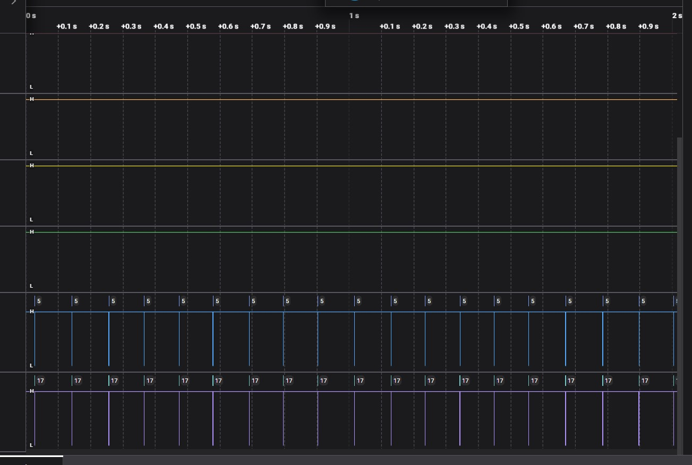

# OTA updates for a formula car
In this article I'll go through the steps I followed to build a custom transport layer protocol to enable a formula car to receive [firmware updates over-the-air](https://en.wikipedia.org/wiki/Over-the-air_update).

Before starting with the project development itself, in the next paragraph you can better understand the reasons why I built it in the first place.

## The purpose of the project
In the 2023 season, I participated as a [UniUD E-Racing](https://formulasae.uniud.it/) team member in some [competitions between universities](https://en.wikipedia.org/wiki/Formula_SAE) where students design a formula style race car and compete against other teams.

<figure>
 
  <figcaption>Fig.1 - Barcelona-Catalunya circuit, practice area.</figcaption>
</figure>

In particular, we took part in the Spanish and Italian competitions as an EV team (i.e. a team that competes with an electric vehicle).

<figure>
 
  <figcaption>Fig.2 - Schematic of the car's VCUs.</figcaption>
</figure>

Our car had N VCU[^1]s in order to work properly and send telemetry data to the box while running. These VCUs were securely stored in specific enclosures that did not expose the boards' serial port, making the wiring harness lighter and easier. However, this design choice caused a problem: every time we had to update the version of the firmware we had to physically disassemble the car, which took a lot of time.

[^1]: Vehicle Control Unit: an electronic control unit that manages a vehicle's system, like controlling the motor speed.

To solve this annoying issue for the incoming competition season, we decided to introduce OTA updates support. An OTA (or over-the-air) update is an update to an embedded system (like a VCU) that is delivered through a wireless network (like Wi-Fi). This technology is the same used for updating smartphones without connecting them to a computer over USB.

## The development
Since we already have a communication system among all VCUs and a base station (a bridge[^2] and a laptop) for telemetry purposes, the most reasonable way to perform OTA updates is to use the same communication channels. More specifically, the communication pipeline looks like this:

[^2]: A bridge is a device that connects two different networks. In our case, it connects the car to the laptop.

<figure>
 
  <figcaption>Fig.3 - Representation of the car's communication pipeline.</figcaption>
</figure>

In other words, we need a way to transfer reliably the update file from our computer to the Target VCU passing through UART, Wi-Fi and CAN bus. Knowing what these protocols are and how they work is not important to understand the rest of the article. Must just be noted that messages circulating in this system are frames with an ID and a content of up to 8 bytes in order to be easily transmitted via CAN bus. An ID is an identification code to distinguish messages; for example, the messages of the throttle and the brakes have different IDs.

<figure>
 
  <figcaption>Fig.4 - A frame in our communication pipeline.</figcaption>
</figure>

So in order to transfer the update file, we need to split it into frames. And to be sure that every frame isn't lost, the receiver must acknowledge every frame. The most simple protocol to do this is stop and wait. Using this method, the sender sends one frame at a time and every time waits for an acknowledge before sending the next frame. If it does not receive it within a certain period of time, it means that the frame was lost. Therefore, the sender resends the frame.

<figure>
 
  <figcaption>Fig.5 - Stop and wait protocol.</figcaption>
</figure>

> **_NOTE:_** In this article the stop and wait protocol is deliberately simplified. For more in depth information about it, I suggest you to read the [Wikipedia page](https://en.wikipedia.org/wiki/Stop-and-wait_ARQ) or the [GeeksforGeeks article](https://www.geeksforgeeks.org/stop-and-wait-arq/).

This protocol is really easy to implement, but as soon as I tested it, I noticed it had a huge problem: it was far too slow. Sending an update would take up to 7 hours. But why? An update file is approximately 2MB and the throughput of the communication pipeline is 500Kbps. If we are using the whole throughput it should take $\frac{8*2MB}{500Kbps} = 32s$. In order to find out what was slowing down the file transfer this much, I connected my Saleae logic analyzer to the CAN bus.

<figure>
 
  <figcaption>Fig.6 - Representation of where the analyzer was connected.</figcaption>
</figure>

Using Logic[^3] I analyzed the CAN bus during an OTA update

[^3]: Software of Saleae's logic analyzers.

<figure>
 
  <figcaption>Fig.7 - Logic screenshot during OTA update using the stop and wait protocol.</figcaption>
</figure>

The vertical lines correspond to frames being transmitted in the can bus. It was clear that for most of the time the channel (CAN bus and therefore UART and Wi-Fi) was left unused. But why? What was happening?

Well, frames were sent by my laptop one at a time, waiting the acknowledge from the Target VCU. The time that a frame required to be acknowledged (called round trip time) was approximately 100ms. So, only one frame every 100ms was sent. The 100ms of "silence" are the huge gaps between frames that can be seen in the screenshot above.

Knowing that each frame contained 8 bytes of data, and that we send a frame every ~100ms, an update file of 2MB would take almost 7hrs to be transferred to the Target VCU:

$$
100s * \frac{2MB}{8B} = \frac{2B*10^8}{8B} = 25 *10^6ms \approx 7h
$$

7h is obviously not fast enough. Disassembling the car and flashing via serial port the VCUs would be much faster. The equation above that estimate the time for the transfer to be completed gives us a hint about how to make the update faster: making the frames bigger. Unfortunately, the standard CAN bus protocol doesn't let us send frames bigger than 8 bytes. What we could do instead is sending multiple frames together as a single "packet" that needs only a single cumulative acknowledge. Theoretically, making the packet as big as the file that we are sending would make our transfer faster. However, losing a single frame would mean sending again the whole update.

To me, 256 frames for each packet seemed like a reasonable choice:
- For each packet we need only 1 byte per frame as index (inside each packet, frames must be indexed in order to know if any was lost).
- Would make the update faster enough: $\frac{2B*10^8}{256 * 7B} \approx 1m 52s$.
- Losing a frame would require to send only 2KiB again.

Using the same setup as before, we can analyze the efficiency (i.e. usage of the channel) of our new protocol.

<figure>
 
  <figcaption>Fig.8 - Logic screenshot during OTA update using packets of 256 frames each.</figcaption>
</figure>

As can be seen in the screenshot above, the channel is now used for more than 1/3 of the time. As expected the time required by an update now is little less than 2 minutes.

## Future improvements

For the purpose of my project, performing an update in \~2 minutes is enough. However, as can be clearly seen in the figure above, there is plenty of room for improvement.

In order to take advantage of almost the whole bandwidth of the channel, we could implement a TCP-like sliding window protocol. Basically, to provide a reliable connection, TCP does not stop to transmit frames while waiting for an acknowledge. 
