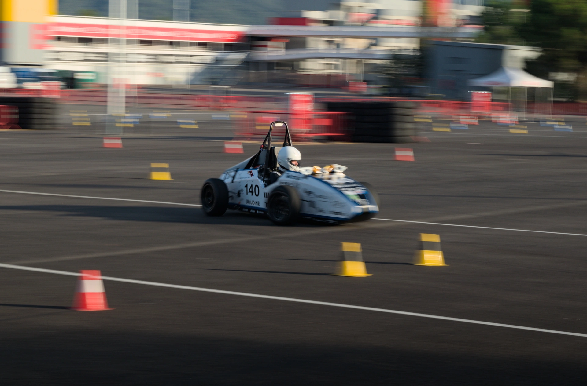
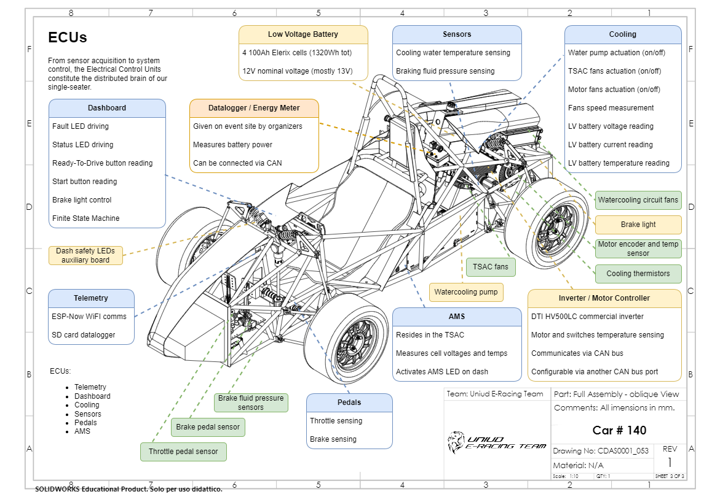
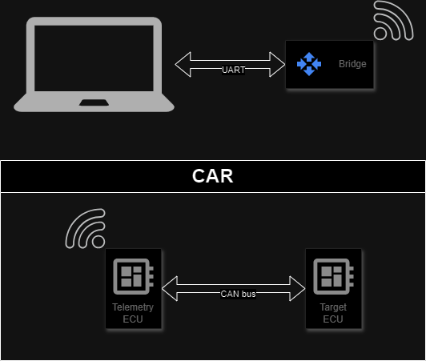
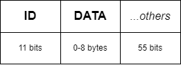
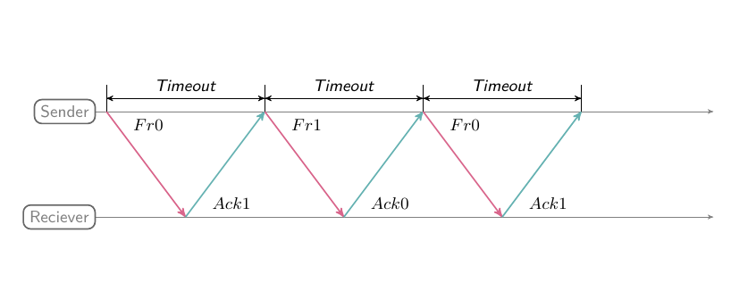
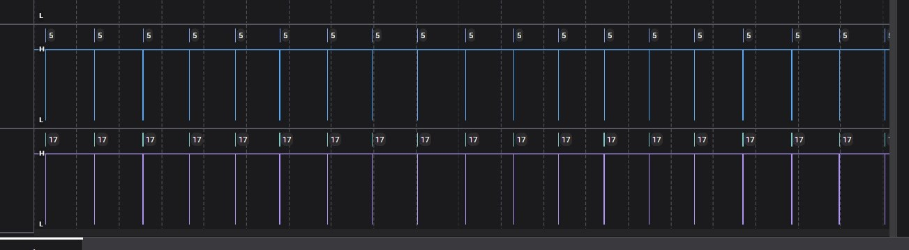
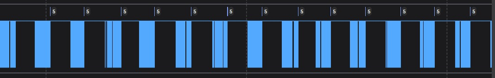

# OTA updates for a formula car
In this article I'll go through the steps I followed to build a custom transport layer protocol to enable a formula car to receive [firmware updates over-the-air](https://en.wikipedia.org/wiki/Over-the-air_update).

Before delving into the details of the project implementation, the next paragraph will give a bit of context, introducing the reasons that led to the problem.

## The purpose of the project
In the 2023 summer season, I took part in a two [inter-university engineering competitions](https://en.wikipedia.org/wiki/Formula_SAE) as a firmware and software developer for the [UniUD E-Racing](https://formulasae.uniud.it/) team.
In these competitions, students design and build a formula style race car to compete against other teams.

<figure>
 
  <figcaption>Fig.1 - Barcelona-Catalunya circuit, UniUD E-Racing car testing in the practice area.</figcaption>
</figure>

In particular, we took part in the Spanish and Italian competitions as an EV team, i.e. a team that competes with an Electric Vehicle.

<figure>
 
  <figcaption>Fig.2 - Schematic of the car's ECUs.</figcaption>
</figure>

Our car had 6 ECU[^1]s in order to work properly and send telemetry data remotely to the box while running. These ECUs were securely stored in specific enclosures that did not expose the boards' serial port, making the wiring harness lighter and easier.

Unfortunately, this design choice caused a problem: every time we had to update the version of the firmware we had to physically disassemble parts of the car, which took a lot of time.

[^1]: Electronic control unit: is an embedded system that controls one or more of the electrical systems in a car.

To solve this annoying issue for the incoming competition season of 2024, we decided to introduce OTA updates support. An OTA (or over-the-air) update is an update to an embedded system (like a ECU) that is delivered through a wireless network (like Wi-Fi). This technology is the same used for updating smartphones without connecting them to a computer over USB.

## The development
Since we already have a communication system among all ECUs and a base station (a bridge[^2] and a laptop) for telemetry purposes, the most reasonable way to perform OTA updates is to use the same communication channels. More specifically, the communication pipeline looks like this:

[^2]: A bridge is a device that connects two different networks. In our case, it connects the car to the laptop.

<figure>
 
  <figcaption>Fig.3 - Representation of the car's communication pipeline.</figcaption>
</figure>

In other words, we need a way to reliably transfer the update file from our computer to the Target ECU passing through UART, Wi-Fi and CAN bus. Knowing what these protocols are and how they work is not important to understand the rest of the article. It is sufficient to notice that messages circulating in this system are frames with an ID and a payload of up to 8 bytes in order to be easily transmitted via CAN bus. An ID is an identification code to distinguish messages; for example, the messages of the throttle and the brakes have different IDs.

<figure>
 
  <figcaption>Fig.4 - A frame in our communication pipeline.</figcaption>
</figure>

So in order to transfer the update file, we need to split it into frames. And to be sure that no frame is lost, the receiver must acknowledge every frame. The most simple protocol to do this is _stop and wait_. Using this method, the sender sends one frame at a time and every time waits for an acknowledge before sending the next frame. If it does not receive it within a certain period of time, it means that the frame was lost. Therefore, the sender resends the frame.

<figure>
 
  <figcaption>Fig.5 - Stop and wait protocol.</figcaption>
</figure>

> **_NOTE:_** In this article the stop and wait protocol is deliberately simplified. For more in depth information about it, I suggest you to read the [Wikipedia page](https://en.wikipedia.org/wiki/Stop-and-wait_ARQ) or the [GeeksforGeeks article](https://www.geeksforgeeks.org/stop-and-wait-arq/).

This protocol is really easy to implement, but as soon as I tested it, I noticed it had a huge problem: it was far too slow. Sending an update would take up to 7 hours. But why? An update file is approximately 2MB and the throughput of the communication pipeline is 500Kbps. If we are using the whole throughput it should take $\frac{8*2MB}{500Kbps} = 32s$. Are we losing so many frames? In order to find out what was slowing down the file transfer this much, I connected my [Saleae](https://www.saleae.com/) logic analyzer to the CAN bus.

> **_NOTE:_** Using an high end logic analyzer like the Saleae paired with a well built software is crucial to efficienly debug and understand what is happening in a communication system.

<figure>
 
  <figcaption>Fig.6 - 2024 car dashboard. The Saleae logic analyzer connected to the CAN bus of target ECU that is receiving the update.</figcaption>
</figure>

Using Logic[^3] I analyzed the CAN bus during an OTA update

[^3]: Software of Saleae's logic analyzers.

<figure>
 
  <figcaption>Fig.7 - Logic screenshot during OTA update using the stop and wait protocol.</figcaption>
</figure>

The vertical lines correspond to frames being transmitted in the CAN bus. It was clear that for most of the time the channel (CAN bus and therefore UART and Wi-Fi) was left unused. But why? What was happening?

Well, frames were sent by my laptop one at a time, waiting the acknowledge from the Target ECU. The time that a frame required to be acknowledged (the round trip time) was approximately 100ms. So, only one frame every 100ms was sent. The 100ms of "silence" are the huge gaps between frames that can be seen in the screenshot above.

Knowing that each frame contained 8 bytes of data, and that we send a frame every ~100ms, an update file of 2MB would take almost 7 hours to be transferred to the Target ECU if no frame is lost:

$$
100ms * \frac{2MB}{8B} = \frac{2B*10^8}{8B} = 2.5 *10^7ms \approx 7h
$$

7 hours is obviously not fast enough. Disassembling the car and flashing via serial port the ECUs would be much faster. The equation above that estimate the time for the transfer to be completed gives us a hint about how to make the update faster: making the frames bigger. Unfortunately, the standard CAN bus protocol doesn't let us send frames bigger than 8 bytes. What we could do instead is sending multiple frames together as a single "packet" that needs only a single cumulative acknowledge.

How big should the packet be in order to maximize the protocol efficiency? To find an answer to this question, I made some assumptions:
- The round trip time is 100ms.
- The probability of losing a frame is 0.5%.
- The overall bandwidth of the channel (the lowest among CAN bus, Wi-Fi and UART) is 500Kbps.
- A packet needs to index its frames in order to know if any was lost. This index requires $⌈\log_2(n)⌉$ bits, where $n$ is the number of frames in the packet.

Given these hypotheses we can find the optimal number of frames for each packet: 65536. An in depth analysis of why this is the most suitable choice can be found in the Desmos graph below.

<figure>
    <iframe src="https://www.desmos.com/calculator/mmmzfczyk8?embed" width="100%" height="300px" style="border: 1px solid #ccc" frameborder=0></iframe>
    <figcaption>Fig.8 - Estimation of the time required by an update with the stop and wait protocol in relation to the length of the sequence number.</figcaption>
</figure>

Using the same setup as before, we can analyze the efficiency (i.e. usage of the channel) of the enhanced protocol version.

<figure>
 
  <figcaption>Fig.9 - Logic screenshot during OTA update using packets of 256 frames each.</figcaption>
</figure>

As can be seen in the screenshot above, the channel is now used for more than 1/3 of the time. As expected, the time required by an update now is little less than 2 minutes.

## Future improvements

For the purpose of my project, performing an update in \~2 minutes is enough. However, as can be clearly seen in the figure above, there is plenty of room for improvement.

In order to take advantage of almost the whole bandwidth of the channel, we could implement a TCP-like sliding window protocol. Basically, to provide a reliable connection, TCP does not stop to transmit frames while waiting for an acknowledge.
